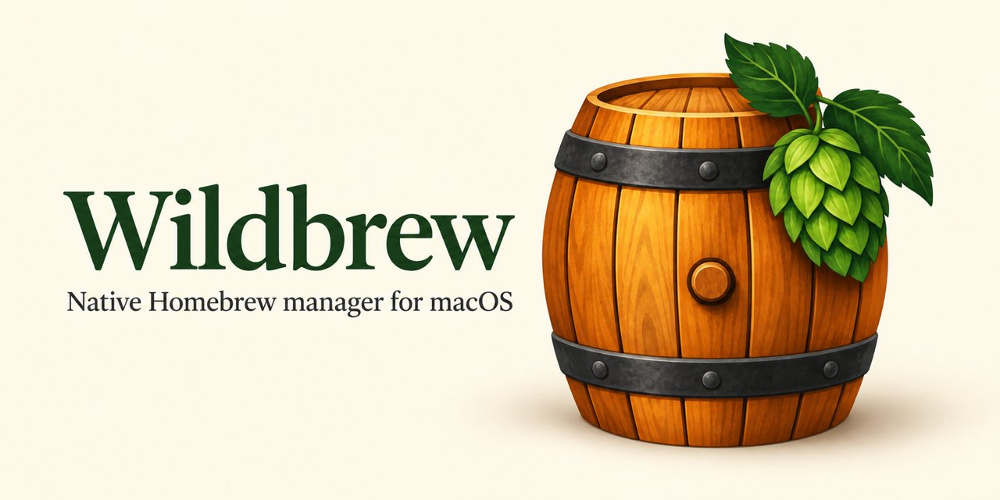
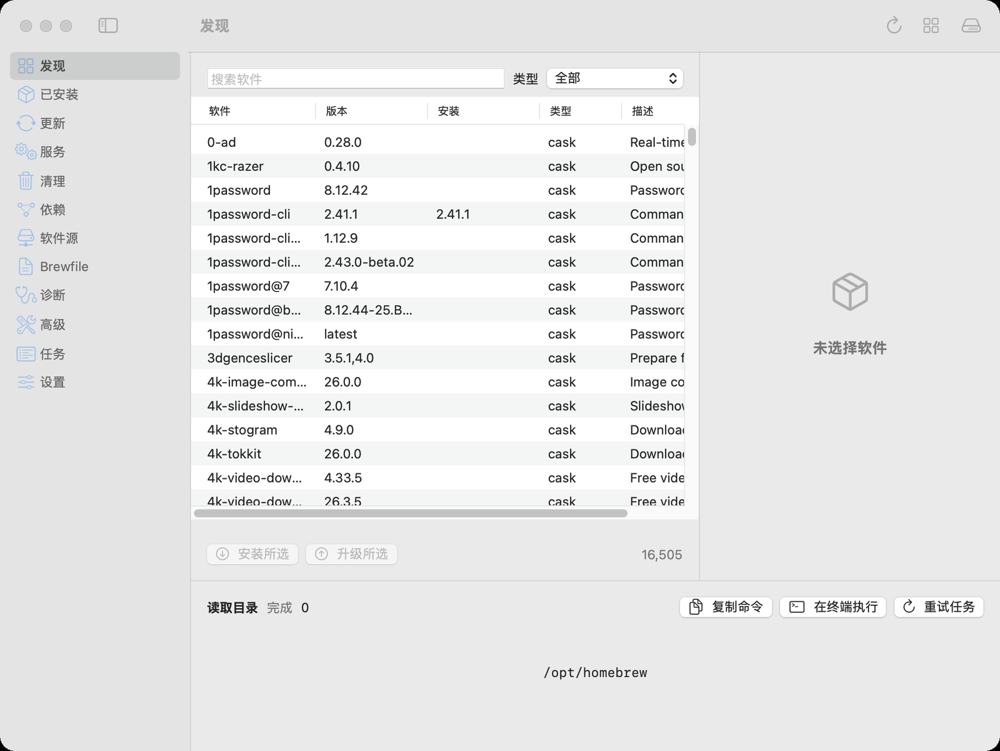

# Wildbrew

English | [简体中文](README.zh-CN.md)

[](https://github.com/nervouna/wildbrew/releases/latest)

[](LICENSE)



Wildbrew is a native macOS app for managing Homebrew: formulae, casks, services, taps and Brewfiles. It runs the `brew` commands for you, one at a time, and shows Homebrew's own output in a task window.



## Status

Wildbrew is a personal, experimental project, built for and used by its author. It is for people who already use Homebrew and want a window on top of it, not a replacement for it.

Wildbrew runs real Homebrew commands on your Mac. They install, upgrade and uninstall software, start and stop services, and change Homebrew settings, exactly as the same `brew` command in Terminal would. Some actions remove things: 清理环境 (Clean up environment) runs `brew bundle cleanup --force`, which removes everything the open Brewfile does not declare, and 卸载并移除数据 (Uninstall and remove data) runs `brew uninstall --zap` on a cask, which also deletes the app's data and shared files. These run when you click them; there is no confirmation dialog. System service actions run as root after the macOS administrator prompt.

To run it you need macOS 15 or later and Homebrew. To build it you need Xcode with Swift 6.2 and Icon Composer support. It has been checked end to end on Apple Silicon with macOS 26; Intel Macs and macOS 15 are targeted but not yet verified ([validation record](docs/validation.md)).

The interface is in Chinese only. This README gives each Chinese name followed by an English translation.

Releases are source only, with no prebuilt app: build it from source as shown below. The build is ad hoc signed for local use, not notarized.

See [CONTRIBUTING.md](CONTRIBUTING.md) to report a bug or send a fix, and [SECURITY.md](SECURITY.md) for security problems.

## Install and update

```sh
git clone https://github.com/nervouna/wildbrew.git
cd wildbrew
./scripts/build-app.sh
```

Copy the resulting `dist/Wildbrew.app` to `Applications` and open it. To update, pull the latest source, build again, quit the app and replace the old copy. The build script does not install software or change your Homebrew.

## Use

Open `Wildbrew.app`. In 设置 (Settings), check the brew 路径 (brew path) and click 保存设置 (Save settings). The default is `/opt/homebrew/bin/brew`, the Apple Silicon location; on an Intel Mac it is usually `/usr/local/bin/brew`.

- 发现 (Discover) browses the official catalog, searches by name, description and type, and installs what you pick. 已安装 (Installed) shows versions, dependencies, licenses, files and metadata, and can upgrade, reinstall, uninstall and pin.
- 更新 (Updates) checks for outdated packages and can update Homebrew itself. With 包含自动更新和 latest (Include auto-updating and latest) on, checks and upgrades include casks that update themselves or use `latest`.
- 服务 (Services) manages user and system services and shows running and registration state separately. System service actions ask for an administrator password through macOS.
- 清理 (Cleanup) previews or removes caches, old versions and unused dependencies. 依赖 (Dependencies) shows the dependency tree, reverse dependencies and link state.
- 软件源 (Taps) adds and removes taps, browses third-party packages, and manages trust records for taps, formulae, casks and commands.
- Brewfile opens, creates, edits, saves and exports environments, checks them, installs them, adds and removes entries, and runs 清理环境 (Clean up environment). The file keeps its raw Ruby content; Wildbrew saves your edits before running a Brewfile command.
- 诊断 (Diagnostics) checks configuration, missing dependencies, links and known vulnerabilities. 高级 (Advanced) shows a formula's history and installs a past version, HEAD or a build from source, prefetches downloads and runs post-install steps. History comes from the Git history of your local taps.

Tasks run one at a time. The task console, at the bottom of each section and in 任务 (Tasks), can cancel a task (取消任务), retry it with its original settings (重试任务), copy its command (复制命令) or hand it to Terminal (在终端执行, Run in Terminal). A running task shows a progress bar that does not measure completion. Wildbrew does not track commands handed to Terminal: click 刷新状态 (Refresh status) when they finish. If a cask install needs an interactive administrator password, run it in Terminal.

## Permissions

- **Administrator password:** only for system service actions, through the standard macOS prompt. Wildbrew does not store it.
- **Automation (Terminal):** macOS asks once, the first time you use 在终端执行 (Run in Terminal).
- The app is not sandboxed. It runs `brew` as your user, with your user's access to files.

## Settings and data

- Settings are kept in macOS UserDefaults after you click 保存设置 (Save settings). Extra environment values are not saved. Wildbrew has no place to enter or store credentials.
- Tasks and their logs, and the package catalogs, stay in memory until the app quits.
- Brewfiles are written only to files you choose. Directory buttons open the real paths Homebrew reports.
- Nothing changes on launch. The periodic update check is off by default; set 更新检查间隔 (Update check interval, in minutes) and save to turn it on while the app runs.
- The 统计 (Analytics) buttons read or change Homebrew's own analytics setting.
- Install options, language, application directory, cache location, and the auto-update and auto-cleanup settings apply to tasks created after you save them.

## Network

Wildbrew downloads the official catalog from `formulae.brew.sh`. Everything else is Homebrew's own traffic: the `brew` commands it runs contact taps, download servers, GitHub and OSV.dev as they would in Terminal.

## Uninstall

Quit Wildbrew and move `Wildbrew.app` to the Trash. To remove its settings too, run `defaults delete com.nervouna.wildbrew`. Packages you installed with Wildbrew stay installed; remove them with `brew` if you want them gone.

## Development

Architecture, build, signing, tests and isolated acceptance in a Tart VM are in [docs/architecture.md](docs/architecture.md). What has actually been verified is in [docs/validation.md](docs/validation.md), and the icon's source files and workflow in [Resources/AppIcon/README.md](Resources/AppIcon/README.md). The build script also produces `dist/wildbrew-check`, a command-line tool that runs the same command layer as the app for acceptance tests. VM disks, download caches and local build output are not committed.

## License

Wildbrew is under the [MIT License](LICENSE). Third-party dependencies keep their own licenses; Swift Subprocess's is in its [repository](https://github.com/swiftlang/swift-subprocess).
